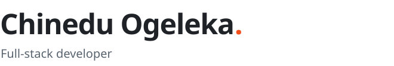

<picture>
  <source media="(prefers-color-scheme: dark)" srcset="assets/header-dark.svg" />
  
</picture>

I'm a full-stack developer in Lagos, and I live in Laravel. In five-plus years I've shipped 400+ projects for 30+ clients in Nigeria, the UK, Ireland and Portugal. Much of that work moves money: payment portals, fintech dashboards, escrow flows and online stores.

I usually take a project from the first commit to production, then keep it fast and secure after launch. On my Laravel builds I write feature tests with Pest, and GitHub Actions runs them and deploys on every push to `main`.

Right now I'm building EdTech platforms and working on bucklid.

### Stack

**Backend** &nbsp; PHP, Laravel, Livewire, Filament, MySQL, Redis 
**Frontend** &nbsp; Vue, React, Next.js, TypeScript, Inertia.js, Tailwind, Alpine.js 
**Payments** &nbsp; Stripe, Paystack, WooCommerce 
**Delivery** &nbsp; Pest, GitHub Actions, Docker, AWS, Nginx

### Contact

[LinkedIn](https://www.linkedin.com/in/nicholas-ogeleka-20637b98/) &nbsp;·&nbsp; [X @dev_leka](https://x.com/dev_leka)
