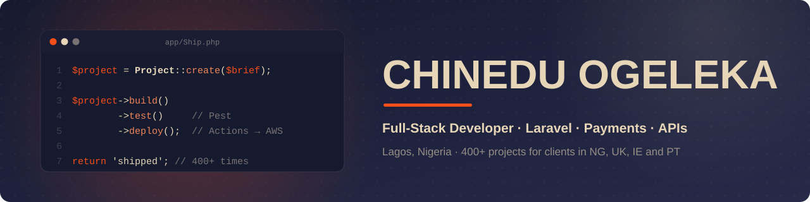

<p align="center">
  
</p>

## 🎯 About me

I'm a full-stack developer in Lagos, and I live in Laravel. In five-plus years I've shipped 400+ projects for 30+ clients in Nigeria, the UK, Ireland and Portugal: a payment portal for a Lagos State agency, fintech dashboards, restaurant ordering, online stores and a creator marketplace. I usually take a project from the first commit to production, then keep it fast and secure after launch.

<table>
<tr>
<td width="56%" valign="top">

```php
$chinedu = [
    'role'     => 'Full-stack developer',
    'location' => 'Lagos, Nigeria 🇳🇬',
    'clients'  => ['NG', 'UK', 'IE', 'PT'],
    'shipped'  => '400+ projects',

    'building' => ['EdTech', 'bucklid'],

    'backend'  => ['Laravel', 'MySQL', 'Redis'],
    'frontend' => ['Vue', 'React', 'Tailwind'],
    'payments' => ['Stripe', 'Paystack'],
    'shipping' => ['Pest', 'Docker', 'AWS'],
];
```

> *"Programs must be written for people to read, and only incidentally for machines to execute."*
>
> Harold Abelson

</td>
<td width="44%" valign="top">
  
</td>
</tr>
</table>

## 📫 Connect with me

<p align="center">
  <a href="https://www.linkedin.com/in/nicholas-ogeleka-20637b98/"></a>
  <a href="https://x.com/dev_leka"></a>
</p>

## 💼 Some things I've built

- **LAWMA TrackItPay**: billing and payments for Lagos State's waste management authority. Residents look up their invoices, track collections and pay online. PHP, MySQL.
- **Automated Exchange IDB**: automated currency exchange and digital banking, with live rates and a dashboard for each user. Laravel, MySQL, JavaScript.
- **MotorCheck**: vehicle history checks for the UK market. MOT history, mileage records and outstanding finance come back in one instant report. Laravel, MySQL, REST API.
- **bucklid**: connects brands with creators across Africa. Payments are held in escrow, and AI helps match brands to creators. Laravel, Vue 3, TypeScript, Redis.
- **Eve After Dark**: online ordering for a London restaurant, with the full menu, bulk orders and Stripe checkout. Built mobile-first. Laravel, Tailwind, Alpine.js.
- **EduRepublic**: payments for a Lagos learning hub's co-working space, event space and coding camp. I also built Borderless, their online learning platform. Laravel, Alpine.js, Tailwind, Paystack.

Right now I'm building EdTech platforms and working on bucklid.

## ⚙️ How I work

Most of my work is Laravel apps and APIs: multi-role platforms, Filament admin panels, REST APIs secured with Sanctum. A lot of it involves money, so I've built plenty of Stripe and Paystack checkouts, escrow flows and billing portals. I also build WooCommerce stores, WordPress sites, booking systems, LMS platforms, AI chatbots, and automations on the WhatsApp Business API.

On my Laravel builds I write feature tests with Pest, and GitHub Actions runs them and deploys on every push to `main`. I use Docker for local and production environments and host on AWS (EC2, S3) or Linux servers running Nginx. I verify payment webhooks and lock down access by role.

## 🛠️ Tech stack

<p align="center">
  
</p>

<p align="center">
  
  
  
  
  
  
  
  
</p>

<p align="center">
  <picture>
    <source media="(prefers-color-scheme: dark)" srcset="https://raw.githubusercontent.com/nicolaschi/nicolaschi/output/github-snake-dark.svg" />
    <source media="(prefers-color-scheme: light)" srcset="https://raw.githubusercontent.com/nicolaschi/nicolaschi/output/github-snake.svg" />
    
  </picture>
</p>
